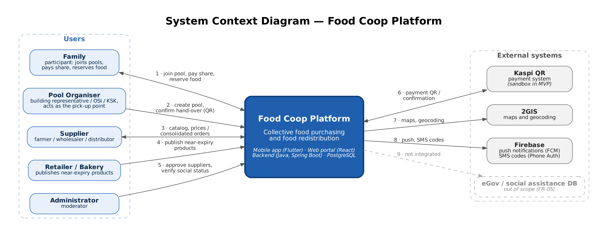
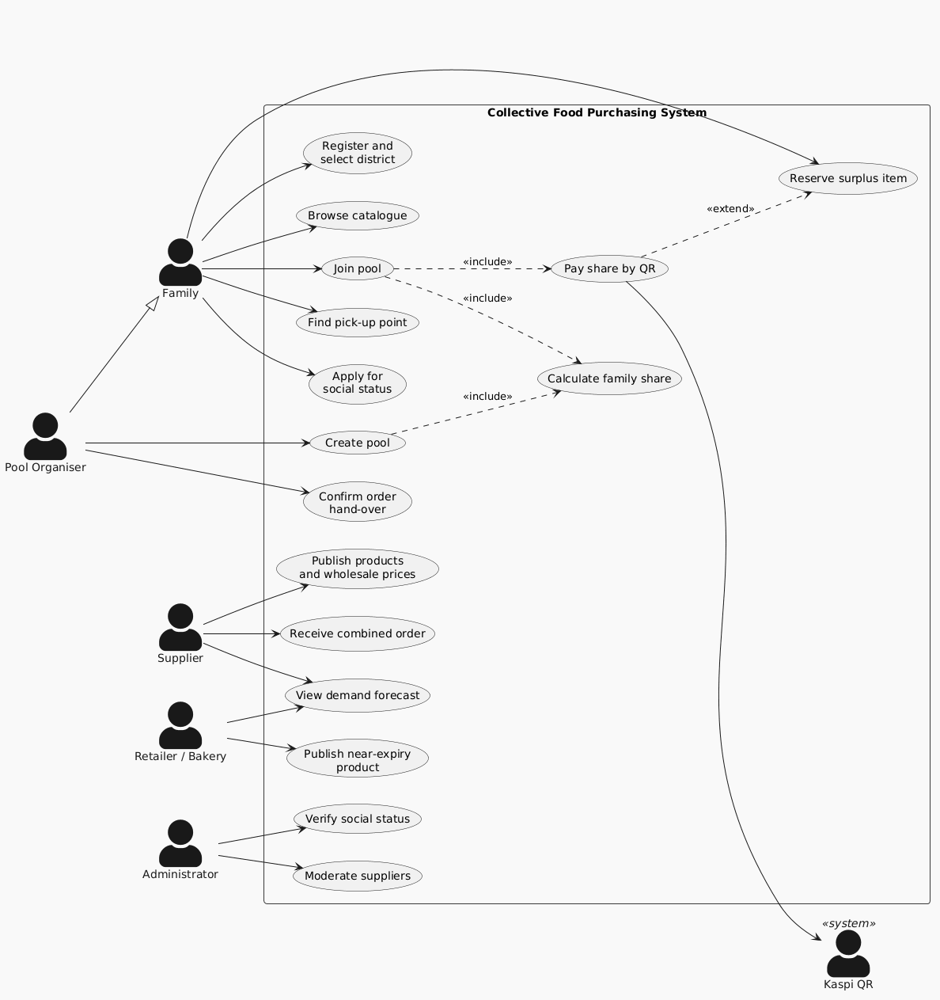
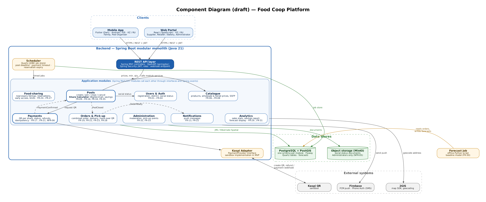
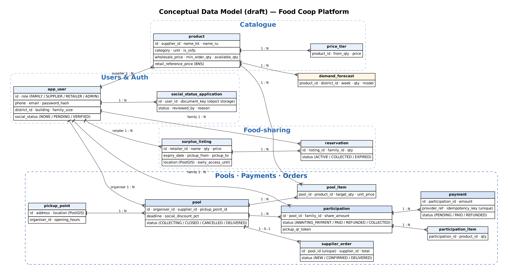

# Architecture and Diagrams

**Project:** Information system for optimizing collective food purchasing and food redistribution
**Owner:** Student B (241755) · **Status:** Draft v0.2
**Related:** Proposal (`01-proposal.md`, DIP-2), Requirements (`06-requirements.md`, DIP-8), Technology comparison (`05-technology-comparison.md`, DIP-7), Verification plan (`09-verification-plan.md`, DIP-15)

| Section | Diagram | Task | Status |
|---|---|---|---|
| 1. System context | `diagrams/source/01-system-context.dot` | DIP-9 | Draft |
| 2. Use cases | `diagrams/source/use-case.puml` (PlantUML, by 241685) | DIP-10 | Draft |
| 3. Components (draft) | `diagrams/source/03-component.dot` | DIP-11 | Draft |
| 4. Architecture description, data model, key scenarios | `diagrams/source/04-data-model.dot` | DIP-12 | Draft |

---

## 1. System context (DIP-9)

*Editable source:* [`diagrams/source/01-system-context.dot`](../diagrams/source/01-system-context.dot) (Graphviz).
*Exports:* [PNG](../diagrams/export/01-system-context.png), [SVG](../diagrams/export/01-system-context.svg).
*Regenerate:* `dot -Tpng -Gdpi=170 diagrams/source/01-system-context.dot -o diagrams/export/01-system-context.png`

The diagram treats the **Food Coop Platform** as a single black box and shows who uses it and which external systems it depends on. Its internal structure (mobile app, web portal, backend modules, database) is shown in the component diagram (section 3).

### 1.1 Actors

Actor names are the same as in the proposal (DIP-2), the requirements (DIP-8) and the use case diagram (DIP-10).

| Actor | Role in the system | Client used |
|---|---|---|
| Family | Joins purchase pools, pays its share, reserves near-expiry products | Mobile app |
| Pool Organiser | Building representative, OSI/KSK or active resident (also a Family). Creates pools and, in the MVP, acts as the pick-up point and confirms hand-over | Mobile app |
| Supplier | Publishes the wholesale catalogue and fulfils combined orders | Web portal |
| Retailer / Bakery | Publishes near-expiry products at a discount or for free | Web portal |
| Administrator | Approves suppliers and retailers, verifies social status documents, manages pick-up points | Web portal |

### 1.2 External systems

| System | Purpose | Integration in MVP |
|---|---|---|
| Kaspi QR | Generating payment QR codes, receiving payment confirmations and refunds | Sandbox / test environment only (real payment processing is out of scope in DIP-2), behind an adapter |
| 2GIS | Map display and address geocoding for pools and pickup points | SDK / API (Google Maps as fallback) |
| Firebase | Push notifications (FCM) and SMS login codes (Phone Auth) | Real integration (free tier) |
| eGov / social assistance databases | Automatic verification of social status (TSA) | **Not integrated** (out of scope in DIP-2, FR-05). Replaced by document upload and manual verification by an Administrator (FR-04) |

### 1.3 Interactions

| # | From → To | Data / action | Requirements |
|---|---|---|---|
| 1 | Family ↔ Platform | Browse catalogue and nearby pools, join a pool and pay the share by QR, see savings, reserve near-expiry products, receive notifications | FR-03, FR-08, FR-10, FR-11, FR-17, FR-25, FR-35 |
| 2 | Pool Organiser → Platform | Create a pool (supplier, products, target quantity, deadline, pick-up point); confirm hand-over by scanning the participant's QR | FR-09, FR-23 |
| 3 | Supplier ↔ Platform | Publish products, prices and minimum order quantities; receive combined orders; update order status; view demand forecast | FR-06, FR-07, FR-19, FR-22, FR-28, FR-30 |
| 4 | Retailer / Bakery → Platform | Publish near-expiry products with discounted price and pick-up window; view demand forecast | FR-24, FR-30 |
| 5 | Administrator → Platform | Approve supplier and retailer accounts, verify social status, block users, manage pick-up points | FR-02, FR-04, FR-32, FR-33 |
| 6 | Platform ↔ Kaspi QR | Request a payment QR for each share; receive payment confirmation via webhook; refunds (sandbox) | FR-17, FR-18, FR-21, NFR-06 |
| 7 | Platform → 2GIS | Load maps, convert addresses to coordinates | FR-03, FR-10 |
| 8 | Platform → Firebase | Send push notifications (pool closed, order ready); send SMS login codes | FR-01, FR-13, FR-22 |
| 9 | Platform ⇢ eGov | Not integrated in the MVP (out of scope in DIP-2) | FR-05 |

### 1.4 System boundary decisions

- **Payments are not processed by the platform itself.** The platform only creates payment requests and receives confirmations. Money moves inside Kaspi and is released to the supplier only when the pool is complete (FR-19). In the MVP, Kaspi runs in a sandbox.
- **Delivery is outside the system.** Suppliers deliver the combined order to the pick-up point by their own means (in-house delivery is out of scope in DIP-2). The platform only tracks the order status.
- **The pick-up point is a role of the Pool Organiser.** In the MVP there is no separate pick-up point operator: the building representative or OSI/KSK who organises the pool also hands over the goods.
- **Status verification is manual.** Without access to state databases, a Moderator checks uploaded documents. Personal data is processed according to NFR-05.

---

## 2. Use cases (DIP-10)

*Editable source:* [`diagrams/source/use-case.puml`](../diagrams/source/use-case.puml) (PlantUML). *Author:* 241685 (DIP-10).

The use case diagram shows 16 use cases for five actors (Family, Pool Organiser, Supplier, Retailer / Bakery, Administrator) and the external Kaspi QR system. The Pool Organiser is a specialisation of Family, so an organiser can also join pools. The mapping of every use case to requirements, modules and tests is given in `06-requirements.md`, section 6.1. The table below shows which backend module implements each use case.

| Use case | Module (section 3) |
|---|---|
| UC1 Register and select district, UC8 Apply for social status | Users & Auth |
| UC2 Browse catalogue, UC11 Publish products and wholesale prices | Catalogue |
| UC3 Join pool, UC4 Calculate family share, UC6 Find pick-up point, UC9 Create pool | Pools |
| UC5 Pay share by QR | Payments + Kaspi Adapter |
| UC10 Confirm order hand-over, UC12 Receive combined order | Orders & Pick-up |
| UC7 Reserve surplus item, UC14 Publish near-expiry product | Food-sharing |
| UC13 View demand forecast | Analytics (+ offline Forecast job) |
| UC15 Verify social status, UC16 Moderate suppliers | Administration (+ Users & Auth) |

---

## 3. Components, draft (DIP-11)

*Editable source:* [`diagrams/source/03-component.dot`](../diagrams/source/03-component.dot) (Graphviz).
*Exports:* [PNG](../diagrams/export/03-component.png), [SVG](../diagrams/export/03-component.svg).
*Regenerate:* `dot -Tpng -Gdpi=140 diagrams/source/03-component.dot -o diagrams/export/03-component.png`

The system consists of two clients, one backend deployed as a **modular monolith**, two data stores and one offline job. The technologies follow the technology comparison (DIP-7).

### 3.1 Clients

| Component | Technology | Users | Responsibilities |
|---|---|---|---|
| Mobile App | Flutter (Dart), Android 8+ / iOS 14+ | Family, Pool Organiser | Catalogue, map of pools and pick-up points (2GIS SDK), joining pools, showing the payment QR and savings, food-sharing reservations, pick-up QR, push notifications, KZ / RU |
| Web Portal | React (TypeScript) | Supplier, Retailer / Bakery, Administrator | Catalogue management, combined orders, near-expiry listings, statistics and forecast, moderation, pick-up points, KZ / RU |

Both clients talk to the backend only through the REST API (HTTPS, JSON, JWT). The TypeScript API client of the portal is generated from the OpenAPI specification.

### 3.2 Backend modules

| Module | Responsibility | Requirements | Owns data (section 4.3) |
|---|---|---|---|
| REST API layer | Controllers, request validation, JWT authentication and role checks, OpenAPI docs, endpoint for Kaspi webhooks | NFR-04 | — |
| Users & Auth | Registration, SMS / password login, district and building, social status applications | FR-01 … FR-04 | app_user, social_status_application |
| Catalogue | Products, wholesale and tiered prices, minimum quantities, SSFP flag, retail reference prices | FR-06 … FR-08 | product, price_tier |
| **Pools** | Pool life cycle (collecting → closed / cancelled → delivered), joining and leaving, **Share Calculator**, social discount, savings, merge suggestions | FR-09 … FR-16, FR-34, FR-35 | pickup_point, pool, pool_item, participation, participation_item |
| **Payments** | QR per share via the PaymentProvider interface, payment status, refunds, idempotent webhook handling | FR-17 … FR-21, NFR-06 | payment |
| Orders & Pick-up | Combined supplier order, delivery status, hand-over by pick-up QR | FR-19, FR-22, FR-23, FR-28 | supplier_order |
| Food-sharing | Near-expiry listings, reservations, early access for social families, daily limits | FR-24 … FR-27 | surplus_listing, reservation |
| Notifications | Push messages via Firebase Cloud Messaging | FR-13, FR-22 | — |
| Analytics | Sales statistics, savings and rescued-food report, display of forecasts | FR-29 … FR-31 | demand_forecast (read) |
| Administration | Moderation of suppliers and retailers, review of status documents, pick-up points | FR-32, FR-33 | — (uses other modules) |
| Scheduler | Quartz jobs: pool deadline, payment timeout, reservation expiry | FR-14, FR-20, FR-25 | Quartz tables |
| Kaspi Adapter | Implementation of the PaymentProvider interface for Kaspi QR (sandbox in the MVP) | FR-17, FR-18, FR-21 | — |

**Module rules.** A module accesses only its own tables. Other modules are used through their public Java interfaces or through Spring application events (`PaymentConfirmed`, `PoolClosed`, `OrderReady`). Spring Modulith verification tests fail the build if a module uses another module's internal classes.

### 3.3 Data stores and offline job

| Component | Purpose |
|---|---|
| PostgreSQL + PostGIS | Main database. One schema per module, Flyway migrations, PostGIS for distance queries, Quartz job store |
| Object storage (MinIO, S3-compatible) | Social status documents. Accessible only through the Users & Auth module, and only for Administrators (NFR-05) |
| Forecast job (Python) | Runs weekly outside the backend, reads completed orders, writes `demand_forecast` (FR-30) |

---

## 4. Architecture description (DIP-12)

### 4.1 Overview

The Food Coop Platform connects families who want to buy staple food at wholesale prices with suppliers who sell only in large batches, and gives the same families access to near-expiry food from local retailers (DIP-2). The architecture is built around one critical process: **a pool collects many small payments and turns them into one supplier order without losing or mis-allocating a single tenge.** Most decisions below follow from this process and from the constraints of a three-person diploma team.

The views in this document fit together as follows:

| View | Question it answers | Source |
|---|---|---|
| Requirements | What must the system do and how is it checked? | `06-requirements.md` (DIP-8) |
| System context (section 1) | Who uses the system and which external systems does it depend on? | DIP-9 |
| Use cases (section 2) | Which goals does each actor achieve? | DIP-10 |
| Components (section 3) | Which parts implement these goals? | DIP-11 |
| Data model (section 4.3) | What information is stored and who owns it? | DIP-12 |
| Key scenarios (section 4.4) | How do the components work together at run time? | DIP-12 |
| Verification (section 4.6) | How is each architectural property tested? | DIP-15 |

### 4.2 Key architectural decisions

| # | Decision | Alternatives | Reason | Requirements |
|---|---|---|---|---|
| AD-1 | **Modular monolith** (one Spring Boot application with strict modules) | Microservices, serverless | Joining a pool, recalculating shares and creating a payment must be consistent. In one application this is a single database transaction. Microservices would need distributed transactions and much more infrastructure for a team of three | FR-11, FR-12, FR-17, NFR-06 |
| AD-2 | **Pay when joining; release funds only when the pool is complete** | Pay after the pool is full | Prepayment to one person causes distrust (DIP-4). Paying on joining fixes the family's place in the pool; refunds protect families if the pool is cancelled. This matches findings on trust in group buying (Liu et al., 2013; Wu et al., 2022) | FR-11, FR-14, FR-17, FR-19, FR-21 |
| AD-3 | **Exact money arithmetic**: `NUMERIC` in the database, `BigDecimal` in Java, rounding remainder assigned to the Pool Organiser | Floating-point numbers | The sum of shares must equal the supplier total to 1 ₸ | FR-12, NFR-07 |
| AD-4 | **Payment provider behind an adapter** (PaymentProvider interface, Kaspi sandbox implementation) | Direct Kaspi API calls | Real merchant access is not available for the diploma; the adapter allows the sandbox now and another provider (Halyk) later. Every webhook carries an idempotency key | FR-17, FR-18, NFR-06 |
| AD-5 | **PostgreSQL + PostGIS** as the single database | MongoDB, MySQL | Strongly relational data (pools, participations, payments, orders), transactions and indexed distance queries for "pools near me" | FR-10, FR-12, FR-24 |
| AD-6 | **Scheduled jobs stored in the database** (Quartz JDBC store) | Message broker, in-memory timers | Pool deadlines, payment timeouts and reservation expiry must fire at an exact time and survive restarts | FR-14, FR-20, FR-25 |
| AD-7 | **Shared pick-up points for pools and food sharing** | Separate collection places | One trip collects both kinds of goods, which reduces extra car trips (Makov et al., 2020) and matches the organiser + pick-up point model (Si, 2024) | FR-10, FR-24, FR-33 |
| AD-8 | **Baseline forecast as an offline job** | ML inside the backend | Start with a simple model and move to ML when enough order data exists (Aichner & Santa, 2023; Tsoumakas, 2019). The core purchasing flow does not depend on it | FR-30 |
| AD-9 | **Two clients: Flutter app for families, React portal for businesses** | Messenger bot, one web app for all | Families need maps, QR codes and push notifications on the phone; suppliers and administrators work with tables at a computer | NFR-01, NFR-12 |
| AD-10 | **Manual verification of social status** with documents in restricted storage | eGov integration | Integration with state databases is out of scope (DIP-2); documents are personal data | FR-04, FR-05, NFR-05 |

### 4.3 Data model

*Editable source:* [`diagrams/source/04-data-model.dot`](../diagrams/source/04-data-model.dot) (Graphviz). Exports: [PNG](../diagrams/export/04-data-model.png), [SVG](../diagrams/export/04-data-model.svg).

| Entity | Owner module | Key rules |
|---|---|---|
| app_user, social_status_application | Users & Auth | One account per phone number. `social_status = VERIFIED` only after an Administrator approves an application |
| product, price_tier | Catalogue | Names in Kazakh and Russian. `retail_reference_price` is used to show savings (FR-35) |
| pickup_point | Pools | Location stored as a PostGIS point |
| pool, pool_item | Pools | `status`: COLLECTING → CLOSED → DELIVERED, or COLLECTING → CANCELLED. Unit prices are fixed when the pool is created |
| participation, participation_item | Pools | `share_amount` is calculated by the Share Calculator. Σ share_amount of PAID participations = supplier_order.total |
| payment | Payments | `idempotency_key` is unique, so a repeated webhook cannot create a second payment |
| supplier_order | Orders & Pick-up | At most one per pool; created only when the pool is CLOSED and all participations are PAID |
| surplus_listing, reservation | Food-sharing | A reservation expires automatically at `pickup_to` |
| demand_forecast | Analytics (written by the Forecast job) | One row per product, district and week |

All amounts are stored as `NUMERIC(12,2)` and processed as `BigDecimal` (AD-3).

### 4.4 Key scenarios

**Scenario A — Join a pool and pay (UC3, UC4, UC5)**

1. The Family opens a pool on the map in the Mobile App and selects quantities (FR-10, FR-11).
2. The REST API passes the request to **Pools**. In one transaction Pools checks the remaining quantity, creates a `participation` with status AWAITING_PAYMENT, and the **Share Calculator** computes the share including any social discount (FR-12, FR-34).
3. Pools asks **Payments** for a QR code. Payments calls the **Kaspi Adapter** (sandbox) and stores a `payment` with status PENDING (FR-17).
4. The Family pays in Kaspi. Kaspi sends a webhook to the REST API. Payments checks the idempotency key, marks the payment PAID and publishes `PaymentConfirmed` (FR-18, NFR-06).
5. Pools marks the participation PAID and updates the fill progress. If the family does not pay within 2 hours, the **Scheduler** releases the quantity (FR-20).

**Scenario B — Pool closes and the supplier receives the order (UC12)**

1. When the paid quantity reaches the target, Pools sets the pool to CLOSED and publishes `PoolClosed` (FR-13).
2. **Orders & Pick-up** creates one `supplier_order` with totals per product; the total equals the sum of shares (FR-19, NFR-07).
3. **Notifications** sends a push to all participants (FR-13). The supplier sees the order in the Web Portal (FR-28).
4. If the target is not reached by the deadline, the Scheduler triggers cancellation: the pool becomes CANCELLED and Payments refunds every paid share (FR-14, FR-21).

**Scenario C — Delivery and hand-over (UC10)**

1. The Supplier marks the order as DELIVERED; Orders publishes `OrderReady`, and families receive a push (FR-22).
2. At the pick-up point, the Pool Organiser scans each family's pick-up QR; the participation becomes COLLECTED (FR-23).

**Scenario D — Reserve near-expiry food (UC14, UC7)**

1. A Retailer / Bakery publishes a listing with a pick-up window in the Web Portal (FR-24).
2. During the first 30 minutes only families with verified social status can reserve free items (FR-26).
3. A Family reserves an item (within the daily limit, FR-27). If it is not collected by the end of the window, the Scheduler expires the reservation and the quantity becomes available again (FR-25, DIP-15 T7).

### 4.5 How non-functional requirements are addressed

| Requirement | Architectural measure |
|---|---|
| NFR-01 Kazakh / Russian | Localisation files in both clients (Flutter ARB, React i18n); product names stored in both languages |
| NFR-02 ≤ 1 s at 100 concurrent requests | Single application without network calls between modules; PostGIS spatial indexes; pagination of lists |
| NFR-04 Security | HTTPS only; JWT with expiry; bcrypt for portal passwords; role checks in the REST API layer |
| NFR-05 Personal data | Documents in separate object storage, accessed only through Users & Auth for the Administrator role |
| NFR-06 Idempotent payments | Unique idempotency key per payment; webhook handling in one transaction |
| NFR-07 Exact calculations | BigDecimal + NUMERIC; Share Calculator isolated in one class and covered by unit tests T1–T7 |
| NFR-11 Maintainability | Module boundaries checked by Spring Modulith tests; code review in Pull Requests |

### 4.6 Verification of the architecture

The verification plan (`09-verification-plan.md`, DIP-15) checks the architecture as follows:

- **Unit tests T1–T7** cover the Share Calculator (Pools), refunds (Payments) and reservation expiry (Food-sharing).
- **The integration test** "create pool → three families join → QR codes generated (sandbox) → pool closes → order appears in the supplier portal" runs Scenarios A and B through the REST API, Pools, Payments, the Kaspi Adapter and Orders.
- **Non-functional tests** check response time (NFR-02), password hashing (NFR-04) and document access (NFR-05).

### 4.7 Deployment (MVP)

All server components run in Docker containers started with Docker Compose: `backend` (Spring Boot), `postgres` (PostgreSQL + PostGIS), `minio` (object storage) and `forecast` (Python job, started weekly). The mobile app is built for Android and iOS; the web portal is served as static files. GitHub Actions runs the tests and the coverage report on every Pull Request.

### 4.8 Open points

| # | Open point | Depends on |
|---|---|---|
| 1 | Payment timeout (2 hours) and social discount values must be confirmed | Interview results (DIP-4) |
| 2 | 2GIS SDK licence terms for a student project; Google Maps is the fallback | Check before implementation |
| 3 | Whether suppliers accept one combined order delivered to a building | Supplier interview (DIP-4, R4) |
| 4 | Detailed sequence diagrams for Scenarios A and B | Next stage (pre-defence 2) |

### References

- Aichner, T., & Santa, A. (2023); Liu et al. (2013); Makov et al. (2020); Si (2024); Tsoumakas (2019); Wu et al. (2022) — see `03-literature-review.md` (DIP-5).
- Spring Modulith documentation: https://docs.spring.io/spring-modulith/reference/
- PostGIS documentation: https://postgis.net/documentation/
- Quartz Scheduler documentation: https://www.quartz-scheduler.org/documentation/
