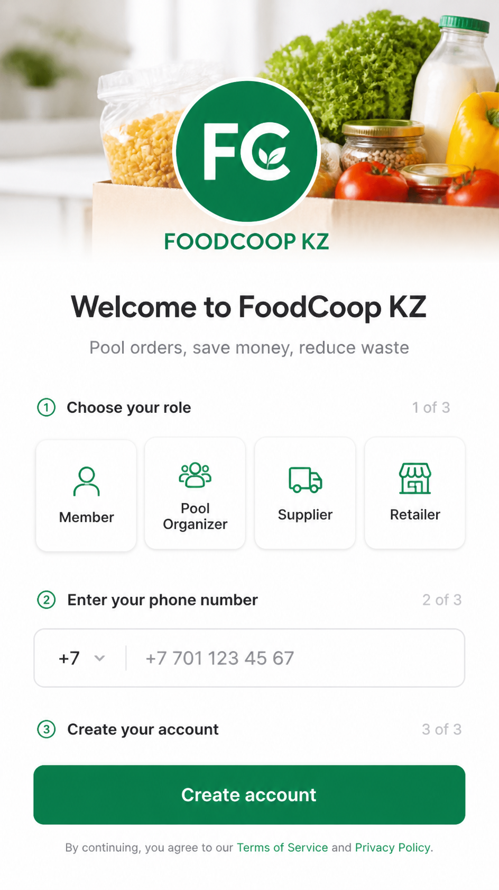
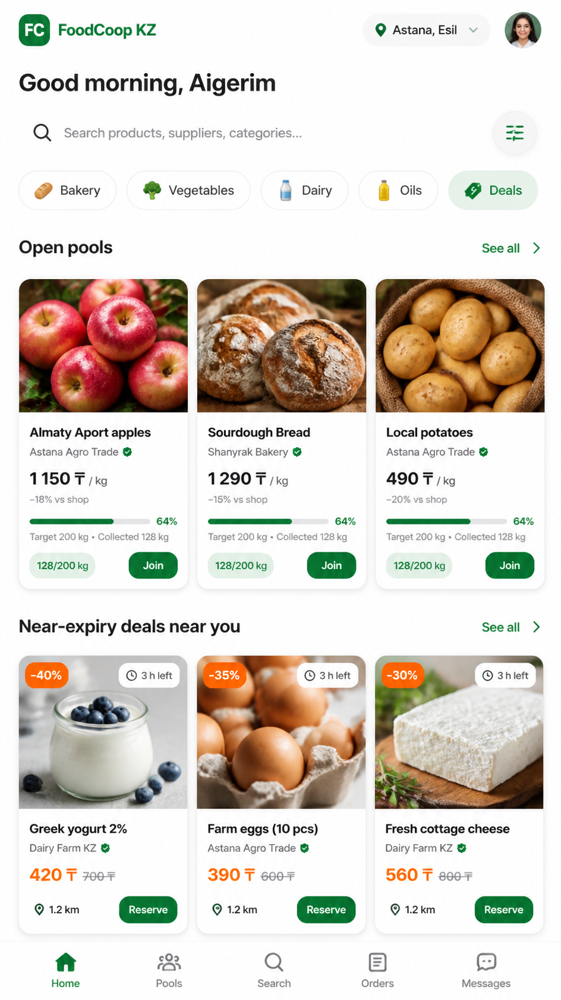
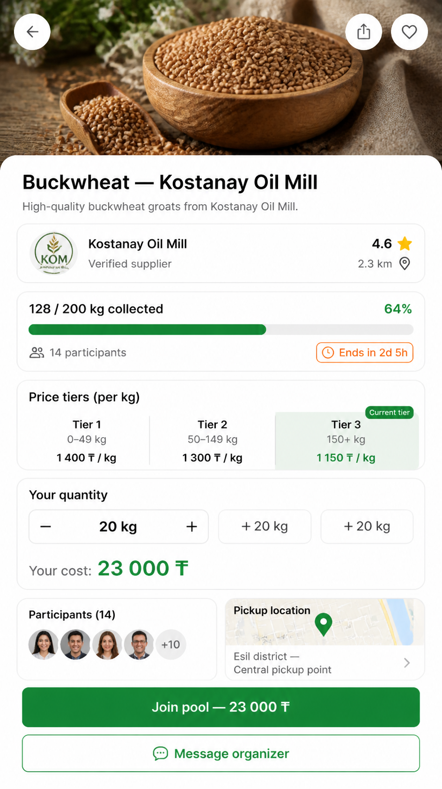
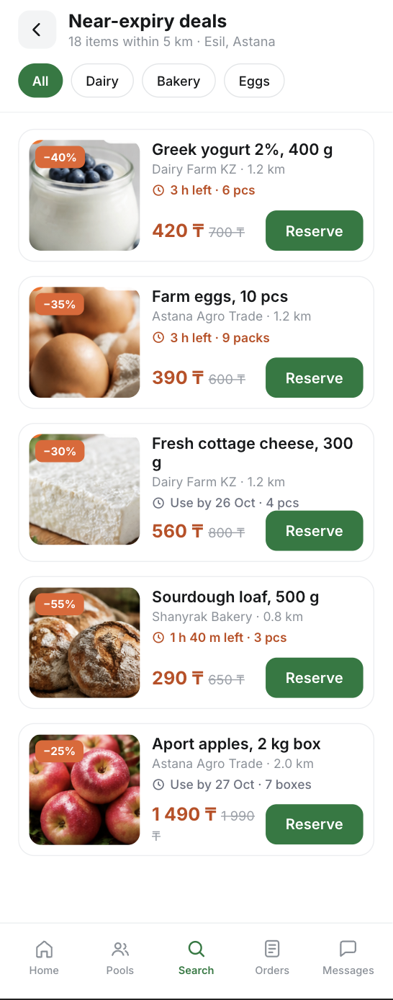
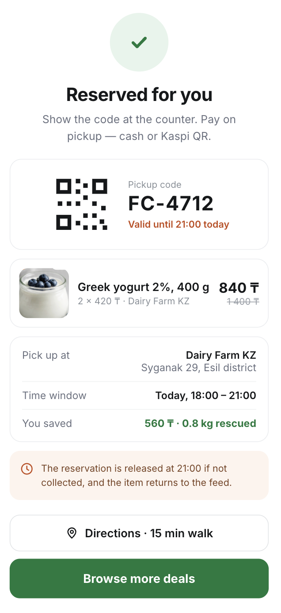

# 08. UX / Prototype

**Project:** Information system for optimizing collective food purchasing and food redistribution
**Task:** DIP-14 · **Status:** v0.2
**Related:** Requirements (`06-requirements.md`, DIP-8), Use case diagram (`07-architecture.md`, DIP-10)

FoodCoop KZ is a mobile app for group food purchases and near-expiry deals in Astana, Kazakhstan (prices in KZT). The mockups below cover the key user scenarios from the use case diagram. Screens are 390 × 812 px.

## Scenarios

| # | Scenario | Actor | Screens | Requirements |
|---|---|---|---|---|
| 1 | Registration and role selection | All users | 01 | FR-01, FR-02, FR-03 |
| 2 | Join a group purchase | Family | 02 → 03 | FR-09, FR-10, FR-11, FR-12, FR-07 |
| 3 | Reserve a near-expiry product | Family | 02 → 04 → 05 | FR-22, FR-24, FR-25, FR-27 |

Scenario 4 (demand forecast and pool creation by the Pool Organiser, FR-09 and FR-30) is specified in the requirements but not yet prototyped. It is planned for the next stage.

## Screens

### 01 · Registration
Role selection, phone number, account creation. The four roles match the actors in `06-requirements.md` section 2.

### 02 · Home
District context, search, categories, open pools with fill progress and near-expiry deals nearby. Entry point for scenarios 2 and 3.

### 03 · Pool details
Verified supplier, fill progress and deadline, tiered prices (FR-07), quantity selector with the cost of the family's share (FR-12), participants and pick-up point.

### 04 · Near-expiry deals
Surplus food nearby with discount, time left before expiry, distance and quantity remaining. The expiry window is shown on every listing, which answers the freshness concern raised in the interviews (DIP-4).

### 05 · Reservation
Pick-up code, item summary, address and collection window, savings. The reservation is released automatically if not collected (DIP-15, test T7).

## Design decisions

| Decision | Reason |
|---|---|
| Mobile first, 390 px | Families and Pool Organisers use the mobile app; Suppliers, Retailers and Administrators use the web portal, which is not prototyped here |
| Expiry window on every surplus listing | Two of three interview respondents rejected near-expiry food over freshness (DIP-4, section 2.3.5) |
| Price tiers shown with the current tier highlighted | Makes the benefit of a larger pool visible, supporting objective O1 |
| Share cost shown before joining | Transparent calculation prevents the disputes identified in DIP-6, conclusion 2 |
| Pick-up point on the pool and reservation screens | Delivery is out of scope; pick-up is the default (DIP-2, section 1.5) |
| Prices in KZT, Astana addresses and local supplier names | The pilot covers one district of Astana |

## Known gaps

- Interface shown in English only; Kazakh and Russian localisation (NFR-01) applies to the implementation.
- Kaspi QR payment flow (FR-17 … FR-19) is not prototyped.
- Administrator screens (supplier approval, social status verification) are not included.
- Scenario 4 screens are planned for the next stage.

## Link to requirements

Scenarios correspond to the use cases in `07-architecture.md` and the functional requirements in `06-requirements.md`.